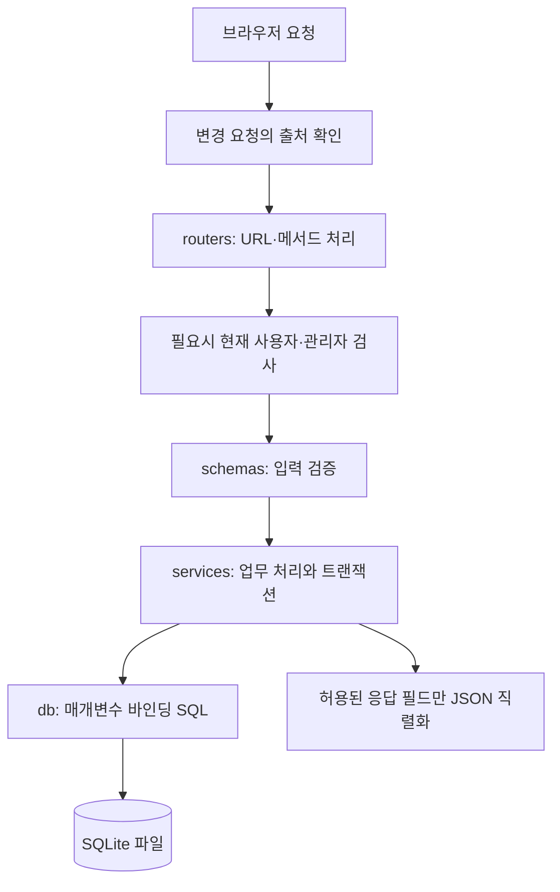
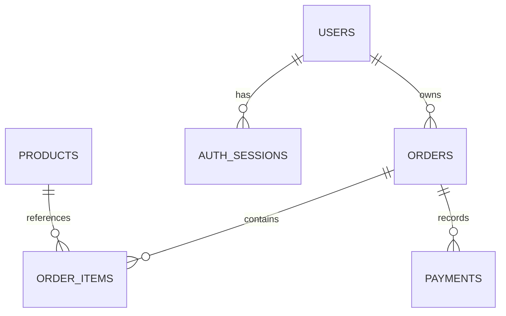

# 현재 코드 구조와 데이터 흐름

현재 구현은 Flask WSGI 서버, 순수 HTML·CSS·JavaScript 화면, SQLite 쇼핑몰 DB, Supabase Auth HTTPS 연동으로 구성됩니다. 인증의 상세 설명은 [AUTH.md](AUTH.md), 서버 배포는 [DEPLOYMENT.md](DEPLOYMENT.md)에 있습니다.

## 1. 폴더 구조

```text
project/
├─ wsgi.py                    # application = create_app()
├─ app/
│  ├─ main.py                 # 설정·DB 초기화, 라우터, HTML·오류·캐시 처리
│  ├─ cli.py                  # DB 확인, 샘플 상품, 역할 변경, Auth 연결 점검
│  ├─ core/
│  │  ├─ config.py            # 프로젝트 기준 .env와 환경변수 검증
│  │  ├─ supabase_auth.py     # Supabase Auth REST 요청
│  │  ├─ security.py          # HttpOnly 쿠키와 인증 오류
│  │  ├─ dependencies.py      # 현재 사용자·관리자 권한 검사
│  │  ├─ csrf.py              # Origin/Referer 확인
│  │  ├─ http.py              # JSON 요청 검증과 응답 직렬화
│  │  └─ errors.py            # 앱의 HTTP/검증 예외
│  ├─ routers/                # auth, members, products, cart, orders, payments, admin
│  ├─ schemas/                # Pydantic 입력·출력 모델
│  ├─ services/               # 인증·세션·회원·상품·장바구니·주문·결제 로직
│  └─ db/                     # SQLite 연결과 users/products/commerce/sessions SQL
├─ templates/index.html       # 공통 HTML과 스크립트 로딩
├─ static/
│  ├─ css/app.css
│  └─ js/
│     ├─ auth-confirmation.js # 인증 결과 URL 정리
│     └─ app.js               # 화면 라우팅과 fetch API 호출
├─ sql/schema.sql             # 현재 SQLite 스키마 v1
├─ sql/seed.sql               # 같은 ID를 덮어쓰지 않는 샘플 상품
├─ instance/shop.sqlite3      # 실행 시 생성하는 DB 파일; Git 제외
├─ tests/                     # 메모리 경계 테스트, 실제 SQLite 통합, JS 콜백 테스트
├─ docs/                      # 배포·구조·Auth·로컬 테스트 문서
├─ requirements.txt
├─ requirements-test.txt
├─ .env.example               # 예시 설정
└─ .env                       # 환경별 실제 설정; Git 제외
```

`sql/legacy-postgres-schema.sql`, `sql/auth-migration.sql`, `sql/reset-shop-db.sql`은 이전 원격 PostgreSQL 구조의 자료이며 현재 SQLite 초기화에서 실행하지 않습니다. 특히 reset 스크립트는 현재 배포 절차에 포함하지 않습니다. 기존 `.mmd`·이미지 자료는 이 문서의 현재 도식과 구분합니다.

## 2. 앱 시작과 요청 처리

`wsgi.py`가 `create_app()`을 호출하면 설정을 읽고 Supabase URL·키의 존재와 URL 형식을 확인합니다. SQLite 파일과 스키마를 준비한 뒤 Flask 라우터와 CLI를 등록합니다. 이 시작 과정은 Supabase PostgreSQL에 연결하지 않습니다.

`PROJECT_ROOT` 기준으로 `.env`, 템플릿, 정적 파일, 상대 DB 경로를 찾으므로 콘솔의 현재 디렉터리에 따라 다른 DB를 만드는 문제를 줄입니다. 운영체제 환경변수가 같은 설정을 제공하면 pydantic-settings의 우선순위에 따라 `.env`보다 우선할 수 있습니다.



보호 API는 클라이언트가 보낸 user_id를 신뢰하지 않고 검증된 현재 사용자의 로컬 id를 서비스에 전달합니다. 관리자 라우터의 일부 SQL은 현재 `routers/admin.py`에 직접 있으며, 모든 SQL이 별도 db 모듈에 있는 것은 아닙니다.

## 3. SQLite 연결과 트랜잭션

`db/connection.py::Connection`은 Python `sqlite3`의 얇은 래퍼입니다. 요청마다 연결을 열어 Flask `g`에서 재사용하고, 요청 종료 시 닫습니다. `db_pool`·`create_pool`이라는 기존 이름은 남아 있지만 실제 반환값은 SQLite 연결 팩토리이며 PostgreSQL 연결 풀이나 백그라운드 연결 스레드가 아닙니다.

연결마다 `PRAGMA foreign_keys=ON`과 15초의 busy timeout을 적용합니다. SQL은 `?` 매개변수 바인딩을 사용합니다. Python UUID는 저장할 때 문자열로 바꾸고 id 관련 컬럼을 읽을 때 다시 UUID 객체로 바꿉니다. DB의 시간은 UTC ISO-8601 문자열, 세션의 절대 만료는 epoch 정수입니다. 원 단위 금액은 INTEGER로 저장합니다.

변경 서비스의 `connection.transaction()`은 `BEGIN IMMEDIATE → 작업 → COMMIT`을 수행하고 실패하면 전체 ROLLBACK합니다. SQLite에는 PostgreSQL의 `FOR UPDATE`가 없으므로 재고를 읽기 전에 쓰기 예약을 확보하는 방식입니다. 한 번에 한 쓰기 트랜잭션만 진행할 수 있습니다. [SQLite 트랜잭션 설명](https://www.sqlite.org/lang_transaction.html).

새 파일은 `PRAGMA user_version=1`로 초기화합니다. 이미 테이블이 있는데 버전이 0인 알 수 없는 파일이나 지원하지 않는 버전은 덮어쓰지 않고 중단합니다. 이 기능은 스키마 버전 확인과 초기화이며 모든 미래 버전의 자동 마이그레이션을 구현한 것은 아닙니다. WAL은 강제로 활성화하지 않습니다.

## 4. 테이블과 관계



| 테이블 | 주요 컬럼 | 역할과 제약 |
| --- | --- | --- |
| users | id, auth_user_id, email, name, phone, address, role, deleted_at | auth_user_id·email UNIQUE, role은 customer/admin, 비밀번호 컬럼 없음 |
| products | id, name, description, price, stock | 가격 양의 정수, 재고 0 이상 |
| orders | id, user_id, status, total_amount, 배송정보, ordered_at, paid_at | cart/pending/paid; 회원당 cart 1개; 주문 확정 후 배송정보·금액 필수 |
| order_items | id, order_id, product_id, product_name, quantity, unit_price | 주문당 상품 조합 UNIQUE, 수량·단가 양수 |
| payments | id, order_id, amount, status, failure_reason | success/failed; 주문당 성공 결제 최대 1개 |
| auth_sessions | token_hash, user_id, encrypted_tokens, expires_at | 브라우저 세션 해시, 암호화한 Auth 토큰, 절대 만료 |

회원의 `auth_user_id`는 원격 Auth 계정과 연결하는 값이고, 외래키는 로컬 테이블 사이에서만 적용합니다. soft delete로 주문 참조를 보존합니다. 정확한 CHECK와 인덱스는 [schema.sql](../sql/schema.sql)을 기준으로 확인하세요.

## 5. 장바구니에서 결제까지

장바구니는 별도 carts 테이블 대신 `orders.status='cart'`인 주문 행을 사용합니다. 장바구니 조회만으로 빈 주문을 만들지는 않습니다. 상품 담기 시 필요한 cart를 만들고 같은 상품은 수량을 더합니다. 가격·상품명·합계는 서버가 DB에서 가져오고 계산합니다.

주문 생성은 장바구니 전환 또는 buy_now 두 경로입니다. cart 주문은 현재 상품 가격과 재고를 다시 확인하고 상품명·단가·합계를 확정해 pending으로 바꿉니다. buy_now는 기존 cart를 유지한 채 별도의 pending 주문을 만듭니다. pending 생성 자체가 재고를 예약하거나 차감하지는 않습니다.

모의 결제는 활성 회원과 주문 소유권, 상태, 기존 성공 기록, 주문항목 합계와 재고를 확인합니다. 성공하면 재고 차감·성공 결제 기록·paid 상태 변경을 같은 트랜잭션에 저장합니다. 재고 부족이면 실패 기록을 커밋하고 409를 반환합니다. 모의 실패 요청은 실패 기록을 남기고 재고를 유지합니다.

같은 paid 주문의 재결제 요청은 성공 기록을 다시 반환하면서 `already_paid=true`로 표시하고 재고를 추가 차감하지 않습니다. 실제 SQLite 통합 테스트는 동시 구매의 초과 판매와 같은 주문의 중복 결제, 작업 중 오류의 롤백을 확인합니다.

## 6. API 목록

| 메서드 | 경로 | 사용 범위 |
| --- | --- | --- |
| POST | /api/auth/signup | 가입 접수 202 |
| POST | /api/auth/login | 로그인·HttpOnly 앱 세션 발급 |
| POST | /api/auth/logout | 현재 앱 세션 폐기 204 |
| GET | /api/products | 공개 목록; limit/offset |
| GET | /api/products/{product_id} | 공개 상세 |
| GET | /api/cart | 본인 장바구니 |
| POST | /api/cart/items | 본인 상품 담기 |
| PATCH / DELETE | /api/cart/items/{product_id} | 본인 수량 변경 / 항목 제거 |
| POST | /api/orders | 본인 주문 생성 201 |
| GET | /api/orders/{order_id} | 본인 주문 상세 |
| POST | /api/orders/{order_id}/payments | 본인 모의 결제 |
| GET / PATCH / DELETE | /api/members/me | 본인 프로필 / 수정 / 탈퇴 |
| PUT | /api/members/me/password | 현재 비밀번호 재인증 후 변경 |
| GET | /api/members/me/orders | 본인 구매내역 |
| POST | /api/admin/products | 관리자 상품 생성 |
| PUT | /api/admin/products/{product_id} | 관리자 상품·가격·재고 수정 |
| GET | /api/admin/orders | 관리자 전체 고객 주문; limit/offset |
| GET | /auth/confirm | 이메일 인증 결과를 정리할 앱 HTML |

입력 오류 422, 인증 실패 401, 관리자 권한 부족 403, 타인/없는 주문 404, 재고 등 상태 충돌 409, DB 연결·인증 서비스 장애 503으로 구분합니다. Auth 요청 제한은 429입니다. 모든 서비스 오류가 하나의 상태로 통일되는 것은 아닙니다.

## 7. 화면과 운영 명령

`static/js/app.js`는 `#/products`, `#/login`, `#/signup`, `#/cart`, `#/checkout`, `#/payment`, `#/account`, `#/orders`, `#/admin`의 hash 라우팅을 사용합니다. fetch는 same-origin 쿠키를 전송합니다. 관리자 메뉴 숨김은 사용 편의를 위한 표시이며 실제 권한 차단은 API가 수행합니다.

`init-db`는 DB 확인, `seed-demo`는 반복 가능한 샘플 상품 입력, `check-auth`는 Auth 설정 HTTPS 조회, `set-role`은 서버 측 역할 변경입니다. 명령의 실제 예시는 [배포](DEPLOYMENT.md)와 [로컬 테스트](LOCAL_TESTING.md) 문서에서 제공합니다.
