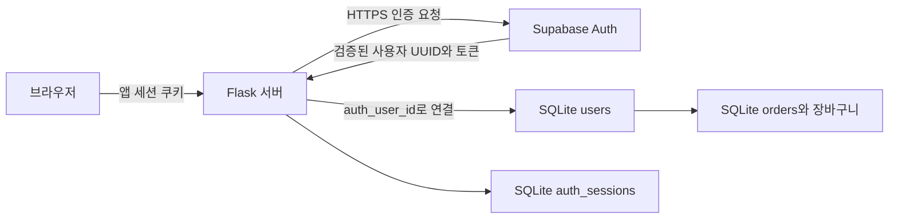
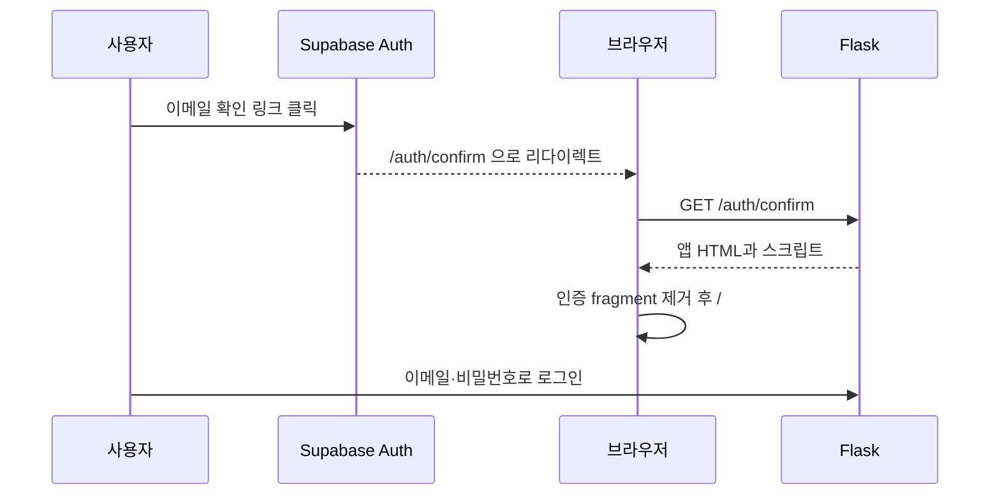

# Supabase Auth와 SQLite는 어떻게 함께 동작하는가

이 앱에서 Supabase Auth는 **사용자가 누구인지 확인하는 인증 서비스**이고, SQLite는 **그 사용자가 쇼핑몰에서 가진 정보와 권한을 저장하는 DB**입니다. 둘은 Flask 서버가 Supabase 사용자 UUID를 기준으로 연결합니다.

## 1. 두 저장소의 역할

| 구분 | Supabase Auth | SQLite |
| --- | --- | --- |
| 계정 | 이메일·비밀번호 인증, 이메일 확인 상태 | 쇼핑몰 회원 프로필 |
| 식별자 | Supabase 사용자 UUID | `users.auth_user_id`에 같은 UUID 저장 |
| 토큰 | access token·refresh token 발급과 갱신 | 앱에서 사용할 토큰을 암호화해 보관 |
| 권한 | Supabase 서비스 자체의 역할·클레임 | 쇼핑몰의 `customer`·`admin` |
| 구매 데이터 | 현재 앱에서는 저장하지 않음 | 상품·장바구니·주문·결제·재고 |

Supabase Auth는 내부 사용자 저장소를 계속 사용합니다. 쇼핑몰 DB를 SQLite로 바꿨다는 것은 Auth의 비밀번호 저장소까지 옮겼다는 뜻이 아닙니다. 앱의 SQLite `users`에는 password나 password_hash 컬럼이 없습니다. [Supabase 사용자 관리](https://supabase.com/docs/guides/auth/managing-user-data).



여기서 로컬 DB라는 표현은 Flask 서버와 같은 환경에 있는 파일을 뜻합니다. 개발할 때는 PC의 `instance/shop.sqlite3`, 배포 후에는 PythonAnywhere의 `/home/kyuyounglee/moashop/instance/shop.sqlite3`입니다. 두 파일의 회원 프로필·주문·권한이 자동으로 동기화되지는 않습니다.

## 2. 회원가입: Auth 계정만 먼저 만든다

사용자가 가입 폼을 제출하면 `POST /api/auth/signup` 라우터가 이메일·비밀번호·이름·연락처·주소를 검증합니다. 이메일은 공백 제거와 소문자 정규화를 적용하고, 요청에 role 같은 허용되지 않은 필드를 넣으면 422를 반환합니다.

`services/auth.py::signup()`은 `core/supabase_auth.py::SupabaseAuth.signup()`을 통해 아래 요청을 보냅니다.

```text
POST {SUPABASE_URL}/auth/v1/signup
     ?redirect_to={APP_ORIGIN}/auth/confirm

JSON: email, password, data(name, phone, address)
```

Supabase의 이메일 인증이 켜져 있으면 사용자가 메일을 확인해야 로그인할 수 있습니다. 꺼져 있으면 가입 직후 로그인할 수 있지만 앱은 두 경우 모두 가입 API에서 자동 로그인하지 않습니다. 가입 응답에 Supabase 세션이 포함된 경우에도 해당 세션을 로그아웃하고 앱 쿠키는 발급하지 않습니다.

응답은 202와 일반적인 가입 접수 안내입니다. 계정 존재 여부를 가입 성공 메시지로 확정해서 알려주는 구조가 아닙니다. 이 시점에는 SQLite 프로필이 생성되지 않습니다. 이메일 인증이 필요한 계정이나 잘못된 자격증명으로 로컬 회원을 먼저 만드는 일을 피하기 위한 방식입니다.

## 3. 이메일 인증: Supabase 확인 후 로그인 화면으로 돌아온다

메일의 확인 링크는 먼저 Supabase의 인증 검증을 수행합니다. 이 링크의 목적지를 단순 로그인 페이지로 대체하면 실제 이메일 확인 절차가 빠질 수 있으므로, 기본 `{{ .ConfirmationURL }}`을 사용합니다.

인증 결과는 앱의 `/auth/confirm`으로 돌아옵니다. Supabase의 implicit 방식에서는 `#access_token=...` 또는 `#error=...` 같은 fragment가 붙을 수 있습니다. fragment는 HTTP 요청 본문이나 쿼리로 Flask에 전달되지 않으므로 브라우저에서 정리합니다.

1. `main.py`가 `/auth/confirm`에 앱 HTML을 제공합니다.
2. HTML은 `auth-confirmation.js`를 `app.js`보다 먼저 로드합니다.
3. `consumeAuthConfirmation()`이 결과 파라미터의 존재를 확인합니다. 토큰을 저장하거나 앱 로그인 자격증명으로 사용하지 않습니다.
4. `history.replaceState()`로 주소를 `/#/login`으로 교체하여 fragment와 쿼리를 제거합니다.
5. 성공 결과면 이메일 인증 안내, 오류면 링크 확인 안내를 표시합니다. 결과 없이 콜백 주소만 열면 성공이라고 단정하지 않습니다.



브라우저가 표시하는 인증 안내만으로 권한이 생기지는 않습니다. 실제 앱 세션은 다음 로그인 단계에서만 생성됩니다. Supabase Site URL이 기본값 `http://localhost:3000`으로 남거나 Redirect URLs가 맞지 않으면 앱 코드에 도착하기 전에 잘못된 사이트로 이동할 수 있습니다. [배포 문서](DEPLOYMENT.md)의 URL 설정과 새 인증 메일 발송 절차를 적용하세요. [Supabase 리다이렉트 설명](https://supabase.com/docs/guides/auth/redirect-urls).

## 4. 로그인: Supabase UUID로 SQLite 프로필을 찾는다

`POST /api/auth/login`은 사용자 입력을 검증한 뒤 Supabase에 비밀번호 로그인을 요청합니다.

```text
POST /auth/v1/token?grant_type=password
JSON: email, password
```

Supabase가 로그인에 성공하면 사용자 정보와 access/refresh token이 서버로 돌아옵니다. Flask는 브라우저가 임의로 보낸 사용자 ID를 사용하지 않고 이 응답의 `user.id`를 사용합니다.

`db/users.py::ensure_auth_profile()`은 다음 순서로 실행합니다.

| 상황 | 동작 |
| --- | --- |
| 같은 auth_user_id가 이미 있음 | 기존 로컬 프로필을 반환하고 이름·주소·역할·탈퇴 상태 유지 |
| 처음 로그인하는 UUID | 이름·연락처·주소의 초기값을 정리하고 customer 프로필 생성 |
| 같은 이메일이 다른 UUID에 연결됨 | 이메일만으로 합치지 않고 409 반환 |
| 기존 회원이 탈퇴 상태임 | 새 프로필로 재생성하지 않고 앱 로그인 차단 |

신규 프로필에는 `id`와 `auth_user_id`를 모두 Supabase UUID로 넣습니다. `id`는 주문·세션이 참조하는 로컬 기본키이고, `auth_user_id`는 Auth 계정을 찾아오는 고유 연결 키입니다. 다른 서버의 DB이므로 `auth.users`를 참조하는 SQLite 외래키는 없습니다. Auth와 로컬 회원의 일치는 서버의 검증 로직이 확인합니다.

예를 들어 Auth가 UUID `11111111-1111-4111-8111-111111111111`을 반환했다면 다음 관계가 만들어집니다. 이 값은 설명용 가상 UUID입니다.

```text
Supabase user.id
    = SQLite users.auth_user_id
    = 신규 SQLite users.id

orders.user_id       → SQLite users.id
auth_sessions.user_id → SQLite users.id
```

이름·연락처·주소는 첫 생성에만 metadata에서 가져옵니다. 그 후 앱에서 수정한 내용은 SQLite를 기준으로 사용하며 Supabase metadata와 양방향 동기화하지 않습니다. Auth 이메일을 외부에서 바꾼 경우 로컬 이메일을 자동 동기화하는 기능도 현재 구현에는 없습니다.

## 5. 브라우저에는 JWT 대신 무작위 앱 세션을 준다

로그인 성공 후 `services/sessions.py::start()`가 무작위 문자열을 만들고, `core/security.py::set_auth_cookie()`가 브라우저 쿠키로 전달합니다.

| 값 | 위치와 용도 |
| --- | --- |
| 무작위 앱 세션 값 | 브라우저의 `shop_access_token` 쿠키 |
| 앱 세션 값의 SHA-256 해시 | SQLite `auth_sessions.token_hash`; 세션 조회 키 |
| Supabase access/refresh token과 만료 정보 | `auth_sessions.encrypted_tokens`; 서버에서 복호화해 사용 |
| 앱 세션 절대 만료 시각 | `auth_sessions.expires_at`; 기본 7일 |

쿠키 이름은 `shop_access_token`이지만 내용은 Supabase JWT가 아닌 앱의 무작위 세션 값입니다. JSON 응답에는 Supabase 토큰이 없고 프론트엔드 localStorage에도 저장하지 않습니다. 이메일 인증 시 provider가 URL에 붙이는 임시 fragment는 별도로 제거합니다.

토큰 묶음은 Fernet으로 암호화합니다. 암호화 키는 SECRET_KEY의 SHA-256 결과를 URL-safe Base64로 변환해 만듭니다. 따라서 SECRET_KEY는 자체 JWT 서명키가 아니라 **서버에 보관한 토큰의 암호화 비밀값**입니다. 키를 바꾸면 기존 세션의 토큰을 복호화할 수 없어서 다시 로그인해야 합니다.

쿠키는 HttpOnly, SameSite=Lax, Path=/이고 배포에서는 Secure=true입니다. HttpOnly는 JS에서 쿠키 내용을 읽는 것을 제한하고, Secure는 HTTPS에서만 전송하게 합니다. SESSION_DAYS는 1~30일 범위이며 기본값은 7일입니다. 로그인 시 만료 시각을 정하고, 매 요청마다 앱 세션 수명을 늘리지는 않습니다. Supabase access token의 수명과 앱 세션 수명은 서로 다른 값입니다.

## 6. 보호 API: 두 서비스의 상태를 함께 확인한다

장바구니·주문·회원정보 등의 라우터는 `get_current_user()`를 호출합니다. 이 함수는 `services/sessions.py::current()`에 실제 검증을 위임합니다.

```text
쿠키 존재 및 길이 확인
 → SHA-256 해시로 SQLite 앱 세션 조회
 → 앱 세션 절대 만료 확인
 → 저장된 Supabase 토큰 복호화
 → 필요하면 access token 갱신
 → GET /auth/v1/user 로 Supabase 사용자 검증
 → 네트워크 요청 중 세션이 삭제됐는지 SQLite 재확인
 → 로컬 회원 활성 상태와 auth_user_id 일치 확인
 → 현재 로컬 프로필·역할 반환
```

검증된 결과는 Flask의 요청 단위 `g.auth_user`에 보관합니다. 같은 요청 안의 재사용을 위한 것이며 다음 요청에서는 다시 확인합니다. 쿠키만 위조하거나, DB에 존재하지 않는 UUID를 입력하거나, 다른 회원의 토큰을 섞어서 접근할 수 없도록 검사합니다.

일반적인 `/user` HTTP 요청은 SQLite의 쓰기 잠금 없이 진행합니다. HTTP 요청 후 로컬 세션을 다시 읽으므로 그 사이 발생한 로그아웃·비밀번호 변경에 의한 세션 삭제도 확인합니다. 다만 이미 실행 중인 별도 작업을 강제 취소하는 구조까지 의미하지는 않습니다.

## 7. access token 만료와 refresh token 회전

서버에 저장한 access token의 만료까지 30초 이하가 남으면 다음 절차를 수행합니다.

1. `BEGIN IMMEDIATE`를 시작합니다.
2. 같은 앱 세션을 다시 읽고 다른 요청이 이미 갱신했는지 확인합니다.
3. 여전히 필요하면 `POST /auth/v1/token?grant_type=refresh_token`을 호출합니다.
4. 새 access/refresh token 묶음을 암호화해 같은 세션 행에 저장하고 커밋합니다.
5. 이후 `/user`를 검증합니다.

SQLite는 이 구간의 쓰기를 직렬화하므로 두 탭이 동시에 만료 토큰으로 요청해도 같은 refresh token을 반복 교체하는 일을 줄입니다. 실제 DB 동시 요청 테스트에서 갱신 1회 수행을 확인합니다. 회전 결과를 `/user` 검사 전에 커밋하므로, 이후 사용자 확인 서비스가 잠시 실패해도 새 토큰 저장을 되돌리지 않습니다.

refresh token이 거부되면 앱 세션을 삭제하고 401을 반환합니다. 인증 서비스 장애나 요청 제한은 정상 로그인으로 간주하지 않으며 503/429 등 실패로 응답합니다. 갱신 중에는 외부 호출을 포함한 쓰기 잠금이 있으므로 다른 쓰기 요청이 대기할 수 있습니다.

## 8. 로그아웃

`POST /api/auth/logout`은 SQLite 세션 삭제를 먼저 커밋하고, 가능하면 보관했던 access token으로 Supabase `/logout?scope=local`도 호출합니다. 마지막으로 브라우저 쿠키를 지우고 204를 반환합니다.

Supabase 로그아웃 요청이 실패해도 이미 수행한 로컬 세션 삭제는 유지합니다. 같은 쿠키 값을 복사해 다시 보내더라도 SQLite 세션이 없어 보호 API에 접근할 수 없습니다. 다른 브라우저의 앱 세션을 전부 지우는 기능은 일반 로그아웃과 구분됩니다.

Supabase JWT 자체가 즉시 무효화된다고 가정하지 않습니다. provider의 access token은 만료까지 유효할 수 있으며, 이 앱은 로컬 세션 조회를 추가하여 앱 접근을 차단합니다. [Supabase 로그아웃 동작](https://supabase.com/docs/guides/auth/signout).

## 9. 권한: Auth의 authenticated와 쇼핑몰 admin은 다르다

Supabase JWT에 있는 `role=authenticated`는 이 쇼핑몰의 관리자 권한이 아닙니다. `user_metadata.role`이나 `app_metadata.role`도 현재 앱의 관리자 판정에 사용하지 않습니다. `require_admin()`은 검증된 로컬 회원의 `users.role`이 admin인지 확인합니다.

| 기능 | 비회원 | customer | admin |
| --- | --- | --- | --- |
| 공개 상품 조회 | 가능 | 가능 | 가능 |
| 장바구니·주문 생성·모의 결제 | 401 | 본인만 | 본인만 |
| 회원정보·비밀번호 변경·탈퇴·구매내역 | 401 | 본인만 | 본인만 |
| 상품 등록·가격·재고 수정 | 401 | 403 | 가능 |
| 전체 고객 주문·배송정보 조회 | 401 | 403 | 가능 |

고객용 주문 API에서는 관리자라도 타인의 주문을 결제할 수 없습니다. 전체 주문 조회는 별도의 관리자 API를 사용합니다. 다른 회원의 주문 UUID를 요청하면 소유권 검사로 404를 반환합니다. 이는 회원이 단순히 로그인했는지 확인하는 것과 별도의 검증입니다.

관리자 지정은 웹 요청으로 받지 않고 서버 CLI로 수행합니다. 먼저 해당 서버에 로그인해 로컬 프로필이 생성돼 있어야 합니다.

```bash
python -m flask --app wsgi:application set-role --auth-user-id '실제-Auth-UUID' --role admin
```

SQLite에는 Supabase RLS가 적용되지 않습니다. 앱 서버가 role과 소유권을 검사하며, 브라우저에는 SQLite 직접 조회·변경 기능을 노출하지 않습니다.

## 10. 비밀번호 변경과 회원 탈퇴

비밀번호 변경은 로그인된 사용자에게 현재 비밀번호를 다시 받아 Supabase 비밀번호 로그인을 수행합니다. 재인증된 UUID가 현재 로컬 회원의 auth_user_id와 같은지 확인한 뒤 Supabase `PUT /user`로 새 비밀번호를 저장합니다. SQLite의 모든 해당 회원 앱 세션을 지우고 쿠키를 제거하므로 다른 브라우저도 다시 로그인해야 합니다. 재인증을 위해 생성한 임시 Supabase 세션은 정리합니다.

회원 탈퇴는 SQLite `users.deleted_at`을 채우는 soft delete입니다. 모든 앱 세션을 삭제하고 기존 주문은 보존합니다. 이후 같은 Auth UUID로 로그인해도 기존 탈퇴 프로필을 발견하여 차단합니다. **Supabase Auth 계정 자체를 삭제하거나 차단하는 관리자 API는 호출하지 않습니다.** 따라서 현재 탈퇴는 이 쇼핑몰 서비스의 이용을 막는 처리입니다.

## 11. 함께 적용된 보호 장치와 구현 범위

변경 요청 POST/PUT/PATCH/DELETE는 Origin 또는 Referer가 APP_ORIGIN과 같은지 확인하고 `Sec-Fetch-Site: cross-site`를 거부합니다. Pydantic 요청 모델은 예상하지 않은 필드와 잘못된 입력을 차단합니다. API 응답에는 `Cache-Control: no-store`를 설정하고 비밀번호·provider 오류 원문을 응답에 포함하지 않습니다.

현재 적용한 Auth 기능은 이메일/비밀번호 회원가입과 로그인, 설정에 따른 이메일 확인, 서버 측 사용자 확인, access/refresh token 갱신, 해당 provider 세션 로그아웃, 현재 비밀번호 재인증과 변경입니다. 앱이 추가한 기능은 SQLite 프로필 연결, 암호화된 앱 세션, role·소유권 검사, 앱 세션 폐기, 로컬 soft delete입니다.

소셜 로그인, MFA, 비밀번호 분실 복구 UI, 인증 메일 재발송 API, Auth 사용자 강제 삭제, 프로필의 양방향 동기화는 구현하지 않았습니다. Supabase가 제공하는 기능과 이 프로젝트에서 실제 연결한 기능을 구분해야 합니다.

## 12. 코드에서 확인할 위치

| 파일 | 읽어볼 내용 |
| --- | --- |
| [supabase_auth.py](../app/core/supabase_auth.py) | 실제 Auth REST 경로와 헤더·오류 처리 |
| [auth.py 라우터](../app/routers/auth.py) | 가입·로그인·로그아웃 API와 쿠키 발급 |
| [auth.py 서비스](../app/services/auth.py) | Auth 성공 후 프로필·앱 세션 연결 |
| [users.py](../app/db/users.py) | 첫 로그인 프로필 생성과 UUID·이메일 충돌 처리 |
| [sessions.py 서비스](../app/services/sessions.py) | 암호화·현재 사용자 확인·회전·폐기 |
| [security.py](../app/core/security.py) | 쿠키 설정과 제거 |
| [dependencies.py](../app/core/dependencies.py) | 현재 사용자·관리자 검사 |
| [members.py 서비스](../app/services/members.py) | 비밀번호 변경과 로컬 탈퇴 |
| [auth-confirmation.js](../static/js/auth-confirmation.js) | 인증 URL 정리와 로그인 화면 이동 |

문제 재현과 테스트는 [로컬 테스트 문서](LOCAL_TESTING.md), Supabase 주소 설정은 [배포 문서](DEPLOYMENT.md)를 참고하세요.
