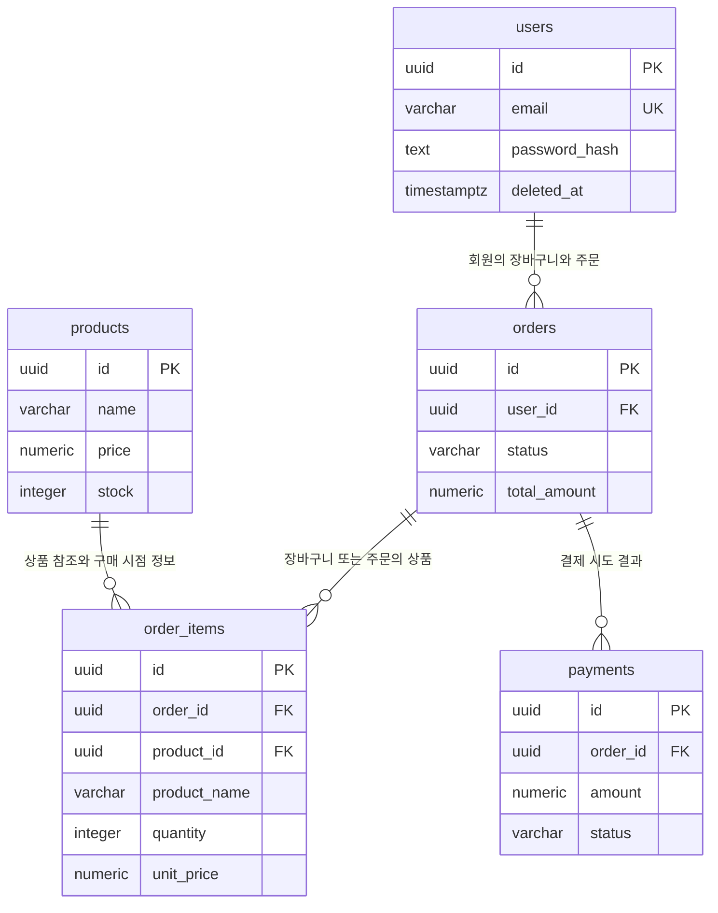

# 쇼핑몰 ERD

`orders`에는 회원과 주문 정보를, `order_items`에는 선택 상품과 수량을 저장합니다. 상품 가격과 재고의 원본은 `products`입니다. 결제는 `orders`에 연결됩니다.

예를 들어 회원 U1이 상품 P1을 담으면 `orders(id=O1, user_id=U1)`과 `order_items(order_id=O1, product_id=P1)`이 연결됩니다. 상품 P2도 담으면 같은 O1을 가리키는 주문상품 행을 하나 더 추가합니다. 따라서 orders에 product_id를 직접 두지 않습니다.

관계도는 구매에 필요한 핵심 컬럼만 표시합니다. 전체 컬럼은 [테이블 정의서](table-definitions.md), 데이터 변화는 [구매 시뮬레이션](purchase-simulation.md)을 참고하세요.

## 관계도

아래 블록은 [erd.mmd](erd.mmd)와 같은 내용입니다. Mermaid를 지원하는 Markdown 미리보기에서 도표로 표시됩니다. `.mmd` 링크만으로는 자동 렌더링되지 않아 본문에도 포함했습니다.

## 관계의 근거

| 관계 | 근거 |
| --- | --- |
| users 1 : N orders | 한 회원은 장바구니와 여러 주문을 가집니다. |
| orders 1 : N order_items | 한 주문에 여러 상품을 담으며, 빈 장바구니도 허용합니다. |
| products 1 : N order_items | 같은 상품을 여러 주문에서 구매합니다. |
| orders 1 : N payments | 실패·재시도 결과를 보존하며, 성공은 한 번만 허용합니다. |

`||`는 정확히 하나, `o{`는 0개 이상입니다. 모든 자식 행은 부모 하나에 속합니다.

## 주문 상태

| 상태 | 의미 | 가능한 동작 |
| --- | --- | --- |
| cart | 장바구니 | 상품 추가·수량 변경·삭제 |
| pending | 주문 확정, 결제 대기 | 결제 시도 |
| paid | 결제 완료 | 구매내역 조회 |

정상 흐름은 **cart → pending → paid**입니다. 결제 실패 시 pending을 유지합니다.

## 가정

- 기존 SQL과 5개 테이블은 유지하며 ERD 표시를 핵심 컬럼으로 간소화했습니다.
- 회원당 장바구니는 하나이며 결제 성공 시 재고를 차감합니다.
