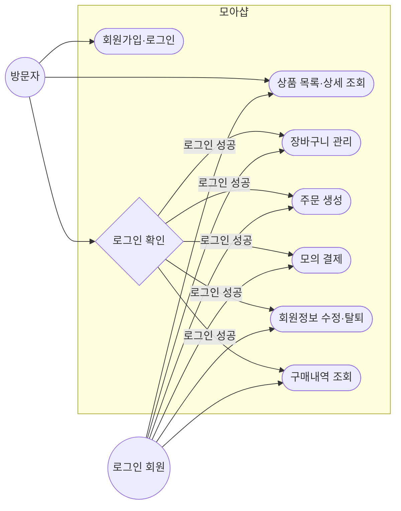
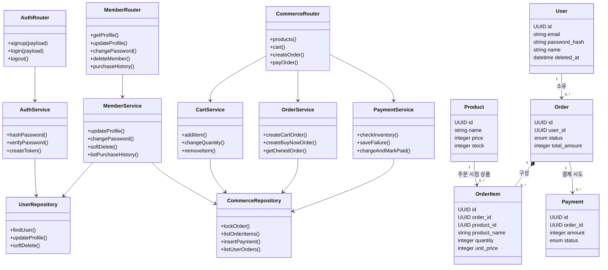
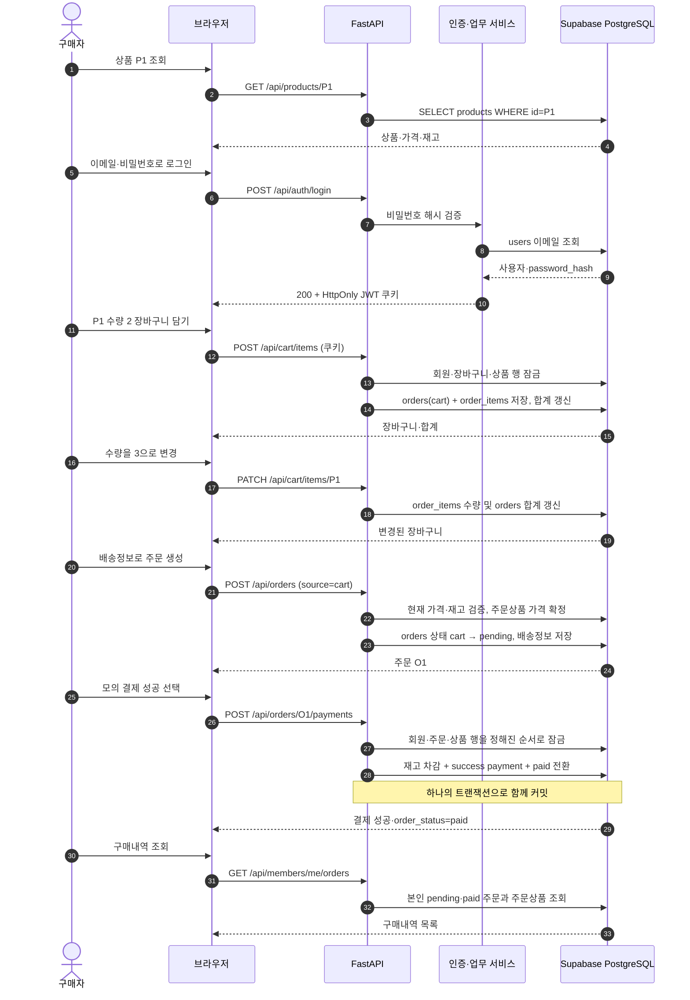

# 모아샵 (Moa Shop) — 쇼핑몰 MVP

> **한 줄 소개**  
> 상품을 둘러보고, 장바구니에 담고, 모의 결제를 거쳐 구매내역까지 확인하는 반응형 쇼핑몰 프로젝트입니다.

**문서 목적:** 기술 스택, 시스템 구조, 핵심 알고리즘, 데이터 흐름과 개발 진행 상황을 한눈에 이해합니다.  
**다이어그램:** 이미지를 생성하지 않고 Mermaid로 직접 작성했습니다. Mermaid를 지원하는 Markdown·Notion 편집기에서 코드 블록을 Mermaid로 렌더링해 확인할 수 있습니다.

---

## 🎬 오프닝 — 프로젝트가 해결하는 일

방문자는 로그인 없이 상품을 볼 수 있습니다. 구매를 시작하면 로그인하고, 장바구니 또는 바로 주문으로 이동합니다. 서버는 주문 시점의 상품명과 단가를 보관하고, 모의 결제 성공 때에만 재고를 차감합니다. 회원은 자신의 주문과 결제 결과를 확인할 수 있습니다.

### 주요 기능

- 공개 상품 목록과 상세 조회
- 회원가입, 로그인, 로그아웃
- 장바구니 상품 추가·수량 변경·삭제
- 장바구니 주문과 바로 주문
- 성공·실패를 선택하는 모의 결제
- 회원정보 수정, 비밀번호 변경, soft delete 탈퇴
- 본인 구매내역 조회

### MVP에서 다루는 경계

- 실제 PG 결제, 카드정보 입력, 환불은 구현하지 않습니다.
- 주문 생성 시 재고를 예약하지 않고, 결제 성공 시 차감합니다.
- 관리자의 상품 등록·수정 화면은 범위에 포함하지 않습니다.
- 프론트엔드는 HTML·CSS·브라우저 JavaScript로 작성하며 React, Node.js, npm을 사용하지 않습니다.

---

## 🧰 기술 스택과 역할

| 영역 | 기술 | 맡은 역할 |
| --- | --- | --- |
| 개발 환경 | VS Code, Python 3.11+ | 코드 작성과 로컬 실행 |
| 웹 서버 | FastAPI, Uvicorn | JSON API와 HTML·정적 파일 제공 |
| 입력·응답 검증 | Pydantic 2 | API 요청값 검증과 응답 형식 지정 |
| DB 연결 | Psycopg 3, connection pool | PostgreSQL 연결, 매개변수 바인딩 SQL, 트랜잭션 |
| 데이터베이스 | Supabase PostgreSQL | 회원·상품·주문·주문상품·결제 저장 |
| 인증 | JWT(HS256), HttpOnly 쿠키 | 로그인 상태 전달 |
| 비밀번호 | Argon2id (`pwdlib`) | 비밀번호 원문 대신 단방향 해시 보관 |
| 프론트엔드 | HTML, CSS, Vanilla JavaScript | 화면 구성, 반응형 스타일, `fetch` API 요청 |
| 배포 목표 | Render | FastAPI 앱 실행과 환경변수 설정 |
| 테스트 | pytest, httpx | API·서비스 동작 검증 |

### 요청이 처리되는 길

```text
브라우저 HTML/CSS/JS
        │ fetch + HttpOnly 쿠키
        ▼
FastAPI Router ── Pydantic Schema
        │
        ▼
Service (업무 규칙·트랜잭션)
        │ 매개변수 바인딩 SQL
        ▼
Psycopg Connection Pool ── Supabase PostgreSQL
```

---

## 🧭 액터 다이어그램 — 누가 무엇을 할 수 있나



> **장면 메모**  
> 상품 구경은 누구나 할 수 있지만, 장바구니·주문·결제·회원 메뉴는 인증된 회원의 요청만 처리합니다. 다른 회원의 주문 ID를 알아도 주문 상세와 결제 API에서 접근을 거부합니다.

---

## 🧩 클래스 다이어그램 — 코드와 데이터의 협업



> **설계 포인트**  
> Router는 HTTP 요청을 받고, Service가 검증·트랜잭션 규칙을 적용합니다. Repository 역할의 `db` 모듈은 SQL을 실행합니다. `order_items`는 주문 당시 상품명과 단가를 저장해 이후 상품 정보가 바뀌어도 주문 내역을 보존합니다.

---

## 🎞️ 웹툰처럼 보는 구매 시나리오

### 1컷 — 손님, 상품 P1을 발견하다

> 🧍 방문자: “상품부터 둘러볼게요.”  
> 🛍️ 모아샵: “로그인 없이 상품 목록과 상세를 볼 수 있어요.”

`products`에서 P1을 읽습니다. 아직 사용자·주문·결제 데이터는 바뀌지 않습니다.

### 2컷 — 회원증을 꺼내다

> 🧍 방문자: “이 상품을 사고 싶어요.”  
> 🔐 모아샵: “먼저 로그인해 주세요.”

로그인 API는 이메일을 조회하고 Argon2id 해시를 비교합니다. 성공하면 JWT를 HttpOnly 쿠키로 전달합니다. 비밀번호는 응답이나 DB 평문으로 남기지 않습니다.

### 3컷 — 장바구니에 P1 두 개

> 🧍 회원: “P1을 2개 담아 주세요.”  
> 🧺 모아샵: “회원 장바구니에 상품과 수량을 기록했어요.”

`orders`에는 로그인 회원 ID와 `status=cart`가 들어갑니다. `order_items`에는 `product_id=P1`, `quantity=2`, 상품명과 담은 시점의 단가가 연결됩니다. 장바구니 총액이 계산되고 재고는 그대로입니다.

### 4컷 — 수량 변경

> 🧍 회원: “수량을 3개로 바꿀게요.”  
> 🧺 모아샵: “3개 기준으로 합계를 다시 계산했어요.”

`order_items.quantity`가 새 수량으로 변경되고 `orders.total_amount`가 다시 계산됩니다. 수량 변경은 재고를 예약하거나 차감하지 않습니다.

### 5컷 — 주문서 작성

> 🧍 회원: “배송지를 입력하고 주문할게요.”  
> 📦 모아샵: “현재 가격과 상품 정보를 주문에 확정했어요.”

배송정보가 `orders`에 저장되고 상태가 `cart`에서 `pending`으로 바뀝니다. `order_items`에는 주문 시점의 상품명·단가·수량이 확정됩니다. 주문 생성만으로 재고는 줄지 않습니다.

### 6컷 — 모의 결제 버튼을 누르다

> 🧍 회원: “결과를 성공으로 선택할게요.”  
> 💳 모아샵: “재고를 확인하고 결제·주문 상태를 함께 저장합니다.”

서버가 주문 합계와 주문상품을 재확인합니다. 성공이면 `products.stock` 차감, `payments.status=success` 기록, `orders.status=paid` 변경을 한 트랜잭션으로 커밋합니다. 실패이면 실패 결제만 기록하고 주문은 `pending`, 재고는 그대로 둡니다.

### 7컷 — 구매내역에서 확인

> 🧍 회원: “내 주문이 잘 저장됐나요?”  
> 📚 모아샵: “본인 주문과 주문 당시 상품 정보를 보여드릴게요.”

`orders`에서 본인 ID와 일치하는 `pending`·`paid` 주문을 조회합니다. `cart` 상태는 제외하고 `order_items`를 함께 표시합니다. 반복 결제 요청은 기존 성공 결제를 반환해 재고가 다시 차감되지 않습니다.

---

## ⏱️ 시퀀스 다이어그램 — P1을 담아 결제하고 내역 확인



---

## 🧠 핵심 알고리즘을 쉬운 말로

### 로그인과 비밀번호

1. 가입 시 비밀번호를 Argon2id로 해시해 `users.password_hash`에 저장합니다.
2. 로그인 시 입력 비밀번호를 저장 해시와 검증합니다. 원문 비밀번호는 저장하지 않습니다.
3. 로그인 성공 시 사용자 ID와 만료·발급자·대상 정보를 담은 HS256 JWT를 HttpOnly 쿠키로 보냅니다.
4. 보호 API는 쿠키 JWT와 DB 회원 상태를 모두 확인합니다. soft delete된 회원은 기존 토큰으로도 거부됩니다.

### 장바구니와 주문 가격

1. 상품 ID와 수량만 요청으로 받습니다. 가격·상품명·회원 ID는 클라이언트 값을 믿지 않습니다.
2. 서버가 상품과 로그인 회원을 조회하고, 모든 SQL 값은 바인딩 파라미터로 전달합니다.
3. `order_items`는 주문 당시 상품명과 단가를 복사해 주문 내역을 보존합니다.
4. 장바구니 상품은 주문 생성 시 현재 가격으로 다시 확인해 `pending` 주문에 확정합니다.

### 재고와 결제의 원자성

1. 결제 서비스가 본인 주문과 주문 합계를 다시 검증합니다.
2. 회원 → 주문 → 상품(ID 오름차순)으로 잠가 동시 요청의 잠금 순서를 일관되게 유지합니다.
3. 성공이면 재고 차감, 성공 결제 기록, 주문 `paid` 변경을 한 DB 트랜잭션으로 처리합니다.
4. 실패이면 실패 결제 기록만 커밋하고 주문은 `pending`으로 둡니다.
5. 부분 유니크 인덱스가 주문당 성공 결제를 하나로 제한하고, 재요청은 기존 결과를 반환합니다.
6. 재고 부족은 결제 실패 내역을 남기면서 409를 반환합니다. DB 오류라면 부분 변경을 롤백합니다.

### 보안·검증

- Pydantic 스키마가 UUID, 수량, 연락처, 비밀번호 등 입력을 검사합니다.
- 동적 SQL 문자열을 만들지 않고 SQL 매개변수 바인딩을 사용합니다.
- 변경 요청은 Origin 또는 Referer를 `APP_ORIGIN`과 비교합니다.
- 쿠키는 HttpOnly·SameSite=Lax이며 HTTPS 배포에서는 Secure 설정을 사용합니다.
- 회원 탈퇴는 `deleted_at`을 기록하고 행을 삭제하지 않아 주문·결제 이력을 보존합니다.

---

## 🗃️ 데이터 테이블 한눈에 보기

| 테이블 | 핵심 데이터 | 관계 |
| --- | --- | --- |
| `users` | 이메일, 해시 비밀번호, 프로필, 탈퇴 시각 | 사용자 1명은 여러 주문을 소유 |
| `products` | 이름, 설명, 가격, 재고 | 주문상품에서 참조 |
| `orders` | 사용자, 상태, 합계, 배송정보, 주문·결제 시각 | `cart`도 주문 행의 상태로 관리 |
| `order_items` | 주문·상품, 주문 시점 이름·단가, 수량 | 주문과 상품을 연결 |
| `payments` | 주문, 서버 결정 금액, 성공·실패 결과 | 실패 재시도는 여러 행, 성공은 주문당 1행 |

상태 흐름은 `cart → pending → paid`입니다. 결제 실패는 `pending`을 유지하고 `payments`에 실패 결과를 추가합니다.

---

## 🛠️ 전체 개발 여정

| 단계 | 만든 것 | 진행 |
| --- | --- | --- |
| STEP 1 | ERD, 테이블 정의, 스키마·샘플 상품 SQL | 완료 |
| STEP 2 | FastAPI 기본 구조, Supabase 연결, 인증 API | 완료 |
| STEP 3 | 상품·장바구니·주문·모의 결제 API와 재고 처리 | 완료 |
| STEP 4 | 회원정보 수정·비밀번호 변경·탈퇴·구매내역 API | 완료 |
| STEP 5 | 상품·로그인·장바구니·주문·회원 화면, 반응형 CSS | 화면 작성 완료, 사용자 브라우저 확인 대기 |
| STEP 6 | 인증이 필요한 화면의 로그인 이동과 원래 화면 복귀 | 예정 |
| STEP 7 | Render 설정, 환경변수·배포 안내 | 예정 |

**테스트 기록:** 사용자가 보고한 백엔드 pytest 결과는 `88 passed, 1 deselected`입니다. 프론트엔드 화면은 STEP 5 작성 이후 브라우저 확인을 기다리고 있습니다.

---

## 🧪 직접 실행할 때

PowerShell `C:\AI4`에서 FastAPI를 실행합니다.

```powershell
uvicorn app.main:app --app-dir .\Day12-Demo\project --reload --reload-dir .\Day12-Demo\project\app --host 127.0.0.1 --port 8000
```

- 쇼핑몰: `http://127.0.0.1:8000/`
- Swagger: `http://127.0.0.1:8000/docs`
- 반응형 확인 폭: 360px / 768px / 1200px

---

## 🏁 엔딩 — 이 프로젝트에서 보여주는 설계

이 MVP의 중심은 “주문 시점 데이터 보존”과 “결제 결과의 원자적 기록”입니다. 브라우저가 보낸 금액을 신뢰하지 않고, 서버가 주문상품을 기준으로 계산합니다. 재고·결제·주문 상태를 한 트랜잭션에서 다루며, 실패 기록과 구매 이력은 필요한 만큼 보존합니다.

> **읽는 순서 추천**  
> 웹툰 구매 장면 → 액터 다이어그램 → 클래스 다이어그램 → 시퀀스 다이어그램 → 핵심 알고리즘 → 개발 여정
