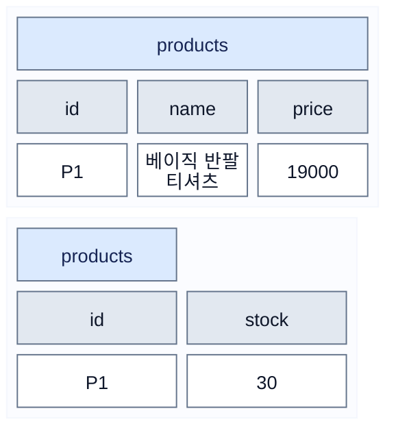
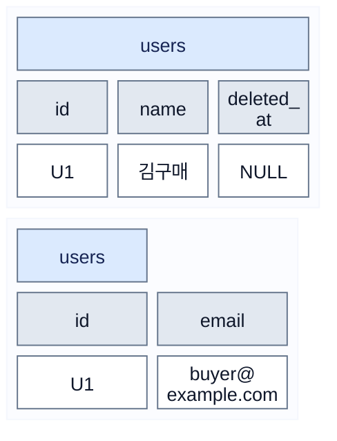
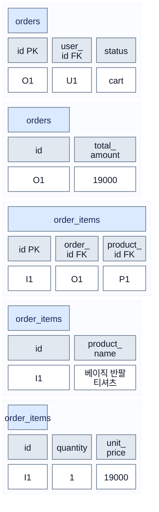
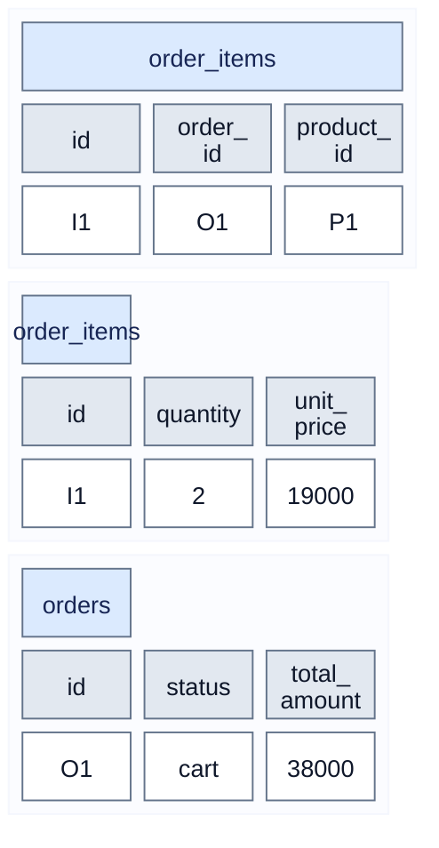
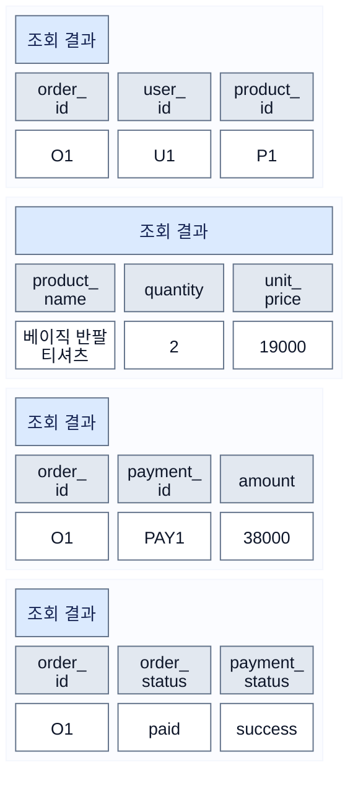

# 상품 구매 시뮬레이션 — 테이블 데이터 변화

[ERD](erd.md) · [테이블 정의서](table-definitions.md) · [전체 Mermaid 원본](purchase-simulation.mmd)

각 표는 **컬럼 헤더와 데이터 행**으로 구성했습니다. 잘림을 피하기 위해 표당 최대 3개 컬럼으로 나누었으며, 같은 ID가 반복되면 동일 행의 다른 컬럼입니다. 긴 헤더·이메일·시각은 셀 안에서 줄바꿈합니다. 단계별 도표를 분리해 연결선이 표 위를 통과하지 않도록 했습니다.

VS Code 미리보기에서 회원 정보·이메일·상품명·주문/상품 연결 키·배송지·결제 결과 표를 확인했습니다. 확인한 표의 컬럼과 데이터에는 오른쪽 잘림이나 텍스트 겹침이 없었습니다. 미리보기가 이전 그림을 표시하면 명령 팔레트에서 `Markdown: Refresh Preview`를 실행하세요.

## 1. 상품 조회 · SELECT



## 2. 로그인 · SELECT



## 3. 장바구니 담기 · INSERT



## 4. 수량 변경 · UPDATE



## 5. 주문 생성 · UPDATE

```mermaid
---
config:
  htmlLabels: false
  theme: base
  themeVariables:
    fontFamily: 'Malgun Gothic, sans-serif'
    fontSize: '14px'
  flowchart:
    htmlLabels: false
---
block-beta
    columns 1
    block:s5t0
        columns 3
        s5t0title["products"]:3
        s5t0h0["id"] s5t0h1["price"] s5t0h2["stock"]
        s5t0v0["P1"] s5t0v1["19000"] s5t0v2["30"]
    end
    style s5t0title fill:#dbeafe,stroke:#64748b,color:#172554
    style s5t0h0 fill:#e2e8f0,stroke:#64748b,color:#0f172a
    style s5t0h1 fill:#e2e8f0,stroke:#64748b,color:#0f172a
    style s5t0h2 fill:#e2e8f0,stroke:#64748b,color:#0f172a
    style s5t0v0 fill:#ffffff,stroke:#64748b,color:#0f172a
    style s5t0v1 fill:#ffffff,stroke:#64748b,color:#0f172a
    style s5t0v2 fill:#ffffff,stroke:#64748b,color:#0f172a
    block:s5t1
        columns 3
        s5t1title["order_items"]:3
        s5t1h0["id"] s5t1h1["order_<br/>id"] s5t1h2["product_<br/>id"]
        s5t1v0["I1"] s5t1v1["O1"] s5t1v2["P1"]
    end
    style s5t1title fill:#dbeafe,stroke:#64748b,color:#172554
    style s5t1h0 fill:#e2e8f0,stroke:#64748b,color:#0f172a
    style s5t1h1 fill:#e2e8f0,stroke:#64748b,color:#0f172a
    style s5t1h2 fill:#e2e8f0,stroke:#64748b,color:#0f172a
    style s5t1v0 fill:#ffffff,stroke:#64748b,color:#0f172a
    style s5t1v1 fill:#ffffff,stroke:#64748b,color:#0f172a
    style s5t1v2 fill:#ffffff,stroke:#64748b,color:#0f172a
    block:s5t2
        columns 3
        s5t2title["order_items"]:3
        s5t2h0["id"] s5t2h1["quantity"] s5t2h2["unit_<br/>price"]
        s5t2v0["I1"] s5t2v1["2"] s5t2v2["19000"]
    end
    style s5t2title fill:#dbeafe,stroke:#64748b,color:#172554
    style s5t2h0 fill:#e2e8f0,stroke:#64748b,color:#0f172a
    style s5t2h1 fill:#e2e8f0,stroke:#64748b,color:#0f172a
    style s5t2h2 fill:#e2e8f0,stroke:#64748b,color:#0f172a
    style s5t2v0 fill:#ffffff,stroke:#64748b,color:#0f172a
    style s5t2v1 fill:#ffffff,stroke:#64748b,color:#0f172a
    style s5t2v2 fill:#ffffff,stroke:#64748b,color:#0f172a
    block:s5t3
        columns 3
        s5t3title["orders"]:3
        s5t3h0["id"] s5t3h1["user_<br/>id"] s5t3h2["status"]
        s5t3v0["O1"] s5t3v1["U1"] s5t3v2["pending"]
    end
    style s5t3title fill:#dbeafe,stroke:#64748b,color:#172554
    style s5t3h0 fill:#e2e8f0,stroke:#64748b,color:#0f172a
    style s5t3h1 fill:#e2e8f0,stroke:#64748b,color:#0f172a
    style s5t3h2 fill:#e2e8f0,stroke:#64748b,color:#0f172a
    style s5t3v0 fill:#ffffff,stroke:#64748b,color:#0f172a
    style s5t3v1 fill:#ffffff,stroke:#64748b,color:#0f172a
    style s5t3v2 fill:#ffffff,stroke:#64748b,color:#0f172a
    block:s5t4
        columns 3
        s5t4title["orders"]:3
        s5t4h0["id"] s5t4h1["total_<br/>amount"] s5t4h2["recipient_<br/>name"]
        s5t4v0["O1"] s5t4v1["38000"] s5t4v2["김구매"]
    end
    style s5t4title fill:#dbeafe,stroke:#64748b,color:#172554
    style s5t4h0 fill:#e2e8f0,stroke:#64748b,color:#0f172a
    style s5t4h1 fill:#e2e8f0,stroke:#64748b,color:#0f172a
    style s5t4h2 fill:#e2e8f0,stroke:#64748b,color:#0f172a
    style s5t4v0 fill:#ffffff,stroke:#64748b,color:#0f172a
    style s5t4v1 fill:#ffffff,stroke:#64748b,color:#0f172a
    style s5t4v2 fill:#ffffff,stroke:#64748b,color:#0f172a
    block:s5t5
        columns 2
        s5t5title["orders"]:2
        s5t5h0["id"] s5t5h1["recipient_<br/>phone"]
        s5t5v0["O1"] s5t5v1["010-1234-5678"]
    end
    style s5t5title fill:#dbeafe,stroke:#64748b,color:#172554
    style s5t5h0 fill:#e2e8f0,stroke:#64748b,color:#0f172a
    style s5t5h1 fill:#e2e8f0,stroke:#64748b,color:#0f172a
    style s5t5v0 fill:#ffffff,stroke:#64748b,color:#0f172a
    style s5t5v1 fill:#ffffff,stroke:#64748b,color:#0f172a
    block:s5t6
        columns 2
        s5t6title["orders"]:2
        s5t6h0["id"] s5t6h1["shipping_<br/>address"]
        s5t6v0["O1"] s5t6v1["서울시 예시로 10"]
    end
    style s5t6title fill:#dbeafe,stroke:#64748b,color:#172554
    style s5t6h0 fill:#e2e8f0,stroke:#64748b,color:#0f172a
    style s5t6h1 fill:#e2e8f0,stroke:#64748b,color:#0f172a
    style s5t6v0 fill:#ffffff,stroke:#64748b,color:#0f172a
    style s5t6v1 fill:#ffffff,stroke:#64748b,color:#0f172a
    block:s5t7
        columns 3
        s5t7title["orders"]:3
        s5t7h0["id"] s5t7h1["ordered_<br/>at"] s5t7h2["paid_<br/>at"]
        s5t7v0["O1"] s5t7v1["2026-10-29<br/>10:00+09"] s5t7v2["NULL"]
    end
    style s5t7title fill:#dbeafe,stroke:#64748b,color:#172554
    style s5t7h0 fill:#e2e8f0,stroke:#64748b,color:#0f172a
    style s5t7h1 fill:#e2e8f0,stroke:#64748b,color:#0f172a
    style s5t7h2 fill:#e2e8f0,stroke:#64748b,color:#0f172a
    style s5t7v0 fill:#ffffff,stroke:#64748b,color:#0f172a
    style s5t7v1 fill:#ffffff,stroke:#64748b,color:#0f172a
    style s5t7v2 fill:#ffffff,stroke:#64748b,color:#0f172a
```



## 6. 모의 결제 성공 · 한 트랜잭션

```mermaid
---
config:
  htmlLabels: false
  theme: base
  themeVariables:
    fontFamily: 'Malgun Gothic, sans-serif'
    fontSize: '14px'
  flowchart:
    htmlLabels: false
---
block-beta
    columns 1
    block:s6t0
        columns 3
        s6t0title["order_items"]:3
        s6t0h0["order_<br/>id"] s6t0h1["product_<br/>id"] s6t0h2["quantity"]
        s6t0v0["O1"] s6t0v1["P1"] s6t0v2["2"]
    end
    style s6t0title fill:#dbeafe,stroke:#64748b,color:#172554
    style s6t0h0 fill:#e2e8f0,stroke:#64748b,color:#0f172a
    style s6t0h1 fill:#e2e8f0,stroke:#64748b,color:#0f172a
    style s6t0h2 fill:#e2e8f0,stroke:#64748b,color:#0f172a
    style s6t0v0 fill:#ffffff,stroke:#64748b,color:#0f172a
    style s6t0v1 fill:#ffffff,stroke:#64748b,color:#0f172a
    style s6t0v2 fill:#ffffff,stroke:#64748b,color:#0f172a
    block:s6t1
        columns 3
        s6t1title["products"]:3
        s6t1h0["id"] s6t1h1["price"] s6t1h2["stock"]
        s6t1v0["P1"] s6t1v1["19000"] s6t1v2["28"]
    end
    style s6t1title fill:#dbeafe,stroke:#64748b,color:#172554
    style s6t1h0 fill:#e2e8f0,stroke:#64748b,color:#0f172a
    style s6t1h1 fill:#e2e8f0,stroke:#64748b,color:#0f172a
    style s6t1h2 fill:#e2e8f0,stroke:#64748b,color:#0f172a
    style s6t1v0 fill:#ffffff,stroke:#64748b,color:#0f172a
    style s6t1v1 fill:#ffffff,stroke:#64748b,color:#0f172a
    style s6t1v2 fill:#ffffff,stroke:#64748b,color:#0f172a
    block:s6t2
        columns 3
        s6t2title["payments"]:3
        s6t2h0["id"] s6t2h1["order_<br/>id"] s6t2h2["amount"]
        s6t2v0["PAY1"] s6t2v1["O1"] s6t2v2["38000"]
    end
    style s6t2title fill:#dbeafe,stroke:#64748b,color:#172554
    style s6t2h0 fill:#e2e8f0,stroke:#64748b,color:#0f172a
    style s6t2h1 fill:#e2e8f0,stroke:#64748b,color:#0f172a
    style s6t2h2 fill:#e2e8f0,stroke:#64748b,color:#0f172a
    style s6t2v0 fill:#ffffff,stroke:#64748b,color:#0f172a
    style s6t2v1 fill:#ffffff,stroke:#64748b,color:#0f172a
    style s6t2v2 fill:#ffffff,stroke:#64748b,color:#0f172a
    block:s6t3
        columns 3
        s6t3title["payments"]:3
        s6t3h0["id"] s6t3h1["status"] s6t3h2["failure_<br/>reason"]
        s6t3v0["PAY1"] s6t3v1["success"] s6t3v2["NULL"]
    end
    style s6t3title fill:#dbeafe,stroke:#64748b,color:#172554
    style s6t3h0 fill:#e2e8f0,stroke:#64748b,color:#0f172a
    style s6t3h1 fill:#e2e8f0,stroke:#64748b,color:#0f172a
    style s6t3h2 fill:#e2e8f0,stroke:#64748b,color:#0f172a
    style s6t3v0 fill:#ffffff,stroke:#64748b,color:#0f172a
    style s6t3v1 fill:#ffffff,stroke:#64748b,color:#0f172a
    style s6t3v2 fill:#ffffff,stroke:#64748b,color:#0f172a
    block:s6t4
        columns 3
        s6t4title["orders"]:3
        s6t4h0["id"] s6t4h1["user_<br/>id"] s6t4h2["status"]
        s6t4v0["O1"] s6t4v1["U1"] s6t4v2["paid"]
    end
    style s6t4title fill:#dbeafe,stroke:#64748b,color:#172554
    style s6t4h0 fill:#e2e8f0,stroke:#64748b,color:#0f172a
    style s6t4h1 fill:#e2e8f0,stroke:#64748b,color:#0f172a
    style s6t4h2 fill:#e2e8f0,stroke:#64748b,color:#0f172a
    style s6t4v0 fill:#ffffff,stroke:#64748b,color:#0f172a
    style s6t4v1 fill:#ffffff,stroke:#64748b,color:#0f172a
    style s6t4v2 fill:#ffffff,stroke:#64748b,color:#0f172a
    block:s6t5
        columns 3
        s6t5title["orders"]:3
        s6t5h0["id"] s6t5h1["total_<br/>amount"] s6t5h2["paid_<br/>at"]
        s6t5v0["O1"] s6t5v1["38000"] s6t5v2["2026-10-29<br/>10:01+09"]
    end
    style s6t5title fill:#dbeafe,stroke:#64748b,color:#172554
    style s6t5h0 fill:#e2e8f0,stroke:#64748b,color:#0f172a
    style s6t5h1 fill:#e2e8f0,stroke:#64748b,color:#0f172a
    style s6t5h2 fill:#e2e8f0,stroke:#64748b,color:#0f172a
    style s6t5v0 fill:#ffffff,stroke:#64748b,color:#0f172a
    style s6t5v1 fill:#ffffff,stroke:#64748b,color:#0f172a
    style s6t5v2 fill:#ffffff,stroke:#64748b,color:#0f172a
```



## 7. 구매내역 · JOIN 조회



## 상품이 주문에 포함되는 연결

- users.id=U1 → orders.user_id=U1: 누가 담았는지 식별합니다. user_id는 요청에서 임의로 받지 않고 검증된 로그인 정보에서 결정합니다.
- orders.id=O1 → order_items.order_id=O1: 어느 장바구니·주문에 담았는지 식별합니다.
- products.id=P1 → order_items.product_id=P1: 어떤 상품인지 식별합니다. 상품명·단가는 서버가 products에서 읽어 함께 저장합니다.
- orders.id=O1 → payments.order_id=O1: 어떤 주문의 결제인지 식별합니다.

orders만 SELECT하면 상품은 보이지 않습니다. 장바구니 화면은 아래처럼 JOIN하여 조회합니다. 이는 조회 결과를 합치는 것이며 별도 VIEW나 테이블을 생성하지 않습니다.

```sql
-- :authenticated_user_id는 로그인 검증 후 서버가 바인딩할 UUID입니다.
-- 사용자 입력을 SQL 문자열에 이어 붙이지 않습니다.
SELECT
    o.id AS order_id,
    o.user_id,
    o.status,
    oi.product_id,
    oi.product_name,
    oi.quantity,
    oi.unit_price,
    oi.quantity * oi.unit_price AS line_amount,
    o.total_amount
FROM public.orders AS o
JOIN public.order_items AS oi ON oi.order_id = o.id
WHERE o.user_id = :authenticated_user_id
  AND o.status = 'cart';
```

위 SQL은 후속 API용 바인딩 예시이며 SQL Editor에 그대로 실행하는 명령이 아닙니다. U1 같은 설명용 ID도 실제 UUID 값으로 사용할 수 없습니다.

## 전체 구조 점검에서 확인한 처리 규칙

- 장바구니 추가는 orders 생성·order_items 추가·합계 갱신을 한 트랜잭션으로 처리합니다. 상품 저장 실패 시 부분 장바구니 변경을 롤백합니다. 기존 cart가 있으면 같은 주문에 상품을 추가합니다.
- 같은 상품을 다시 담으면 기존 order_items 수량을 올립니다. 다른 상품 P2를 담으면 같은 O1을 가리키는 별도 주문상품 행을 추가합니다. orders에 product_id 하나만 두면 이 관계를 표현할 수 없습니다.
- 주문 생성 시 상품명·단가를 현재 값으로 확정하고 재고를 검증합니다. 재고 예약·차감은 하지 않습니다.
- 결제 시 O1의 order_items에서 P1과 수량 2를 읽어 해당 상품 재고를 차감합니다. 재고·결제 결과·주문 상태는 한 트랜잭션으로 커밋합니다.
- 결제 실패는 failed 행만 남기고 pending 상태와 재고를 유지합니다. 이미 성공한 주문은 기존 결제 결과를 반환하고 재고를 다시 차감하지 않습니다.
- 구매내역에는 로그인 회원의 paid 주문과 success 결제만 연결합니다. 여러 상품을 JOIN하면 주문 합계가 행마다 반복될 수 있으므로 반복된 total_amount를 다시 합산하지 않습니다.
- 탈퇴는 users.deleted_at을 기록하고 주문상품·결제 내역은 보존합니다.

## 가정과 확인 범위

- 실제 DB 조회 없이 schema.sql의 FK·필수 컬럼·상태 제약과 예시의 연결·합계를 문서 기준으로 점검했습니다. SQL 실행·API 테스트는 하지 않았으며 레이아웃은 위에 명시한 표를 VS Code 미리보기에서 확인했습니다.
- 기존 회원 U1이 P1 두 개를 구매하며 가격 변동은 없습니다. 예시 상품명·단가·초기 재고는 seed.sql의 첫 상품과 동일합니다.
- U1·P1·O1·I1·PAY1은 설명용 축약 ID이고 실제 저장 타입은 UUID입니다. 시각은 한국 시간 예시입니다.
- 표는 주요 컬럼만 표시합니다. users.password_hash 등 생략한 필수 컬럼이 실제 DB에서 누락된다는 의미는 아닙니다. 기본값 없는 필수 컬럼은 실제 INSERT 시 모두 지정해야 합니다.
- Mermaid block-beta를 지원하는 Markdown 미리보기에서 표를 확인할 수 있습니다. HTML table과 foreignObject를 사용하지 않습니다. SQL과 테이블 수는 변경하지 않았습니다.


